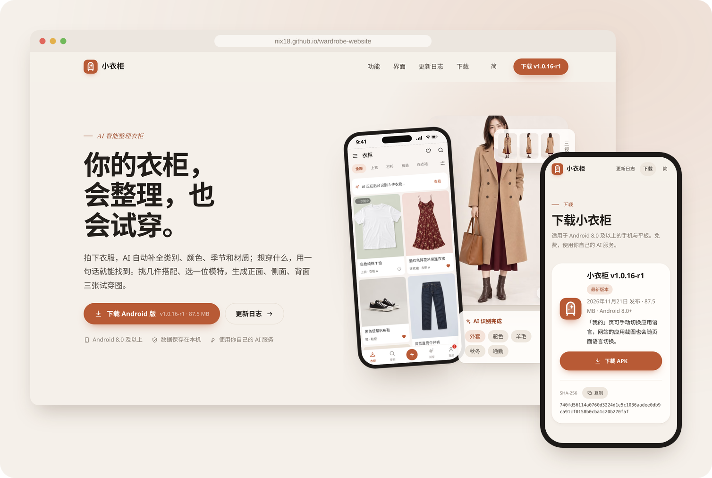
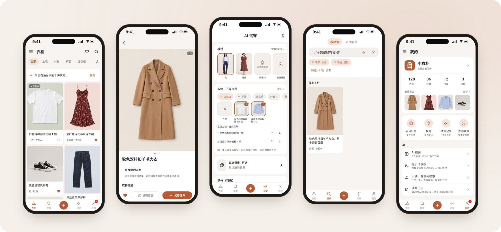

<p align="center">
  
</p>

<h1 align="center">Wardrobe · Website</h1>

<p align="center">
  English · <a href="README.zh-CN.md">简体中文</a>
</p>

<p align="center">
  <a href="https://nix18.github.io/wardrobe-website/?lang=en">nix18.github.io/wardrobe-website</a>
</p>

<p align="center">
  <a href="https://github.com/nix18/wardrobe-website/releases/latest"></a>
  
  
</p>



Wardrobe is an Android app for organizing clothes, tagging photos with AI, searching in your own words, and generating front, side, and back try-on views. This repository hosts its website and [public APK releases](https://github.com/nix18/wardrobe-website/releases).



## Pages and languages

| English path | Page |
| --- | --- |
| `/` | Features, try-on workflow, screenshots, recent updates, and FAQ |
| `/download/` | Latest APK, installation steps, and SHA-256 |
| `/download/history/` | Previous releases |
| `/changelog/` | Changelog with the latest three releases expanded |
| `/privacy/` | App privacy policy and the website’s language lookup disclosure |

Use `/zh/`, `/zh-hant/`, `/fr/`, `/pt/`, `/es/`, `/de/`, or `/ja/` for Simplified Chinese, Traditional Chinese, French, Portuguese, Spanish, German, or Japanese. English uses the unprefixed paths. The site uses ipapi.co to infer the visitor’s country or region, including Traditional Chinese for Taiwan, Hong Kong, and Macao and Simplified Chinese for mainland China. English is the fallback. The header language menu remembers a manual choice. All locales have static URLs that work without JavaScript.

Shared styles are in `src/styles/global.css`. The site follows the visitor’s color scheme and honors reduced-motion settings for the screenshot gallery.

## Local development

Use Node.js 22.19 or later.

```bash
npm ci
npm run dev
npm run check
npm run build
npx playwright install chromium --only-shell
npm run test:layout
```

`npm run build` checks the generated pages and their local links and assets. The Playwright suite covers mobile and desktop layout plus language selection.

## Releases and deployment

After building the Android release APK:

```bash
npm run release -- 1.0.14 --source-repo nix18/clothes-app-workspace --summary "Short release summary"
git add src/content/releases && git commit -m "Release v1.0.14" && git push
```

The release tool downloads the APK from the app repository, verifies the original SHA-256, uploads and verifies a public draft, publishes it, and writes the release metadata to `src/content/releases/`. Replacing an existing APK requires `--replace`. Revisions such as `1.0.15-r1` have their own tags and APKs. The updater omits the Downloads section from release notes and accepts additional headings via `--drop`.

Add an English summary for each new version in `src/data/release-summaries.en.json`. Place the English notes in `src/data/releases/en/v<version>.md`. The English changelog also links to the original Chinese notes.

The Pages workflow tests and builds the site, updates `gh-pages` with the verified output, and requests a publication. Set the Pages source to **Deploy from a branch → gh-pages → /** and allow `gh-pages` in the `github-pages` environment. Use `npm run deploy` only to retry a remote deployment manually. After publishing, verify the public APK’s SHA-256, version, download page, and release notes.

## Images

| Path | Source and regeneration |
| --- | --- |
| `src/assets/screens/` | Run `./gradlew :app:testDebugUnitTest -Pscreenshots` in the app repository |
| `src/assets/photos/` | Run `npm run gen-images` with `IMAGE_API_BASE` and `IMAGE_API_KEY`. Prompts are in `art/photo-prompts.mjs`. |
| `public/og.png`, `public/icon-180.png` | Run `npm run og-image` |
| `docs/readme/` | Run `npm run readme-images`. The website preview also needs two screenshots. |

The model, garment, and try-on photos on the site are AI-generated examples.
