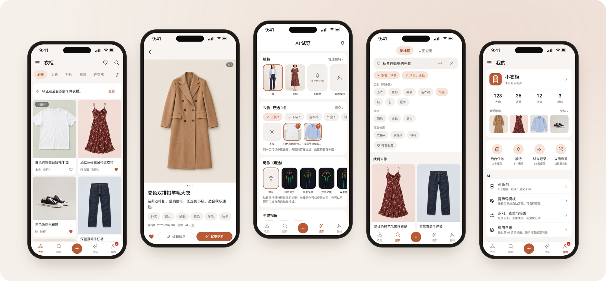

<p align="center">
  
</p>

<h1 align="center">小衣柜 · 网站</h1>

<p align="center">
  <a href="https://nix18.github.io/wardrobe-website/">nix18.github.io/wardrobe-website</a>
</p>

<p align="center">
  <a href="https://github.com/nix18/wardrobe-website/releases/latest"></a>
  
  
</p>


小衣柜是一个 Android 衣橱应用：拍照收衣服，AI 补标签，一句话找出来，挑几件生成正面、侧面、背面的试穿图。这里是它的网站，安装包也发在这个仓库的 [Releases](https://github.com/nix18/wardrobe-website/releases)。



## 页面

| 路径 | 内容 |
| --- | --- |
| `/` | 功能、试穿流程、界面截图、最近更新、常见问题 |
| `/download/` | 最新版、安装步骤、SHA-256 |
| `/download/history/` | 历史版本 |
| `/changelog/` | 最近 3 个版本，再往前的收在“更多版本”里 |
| `/privacy/` | 隐私政策，和应用里的一致 |

首页的界面截图跟着滚轮走：往下滚时横向滑动，滑到最后一张再继续往下。深色模式跟随系统。没有客户端 UI 框架；共享样式在 `src/styles/global.css`，页面局部样式跟随各 Astro 页面。禁用脚本时正文仍可见。

## 本地跑

Node.js 22.19 以上。

```bash
npm ci
npm run dev       # http://localhost:4321/wardrobe-website/
npm run check     # 发布工具单元测试
npm run build     # 构建并检查本地链接与图片
npx playwright install chromium --only-shell # 首次安装浏览器
npm run test:layout # 320–430px 手机及桌面真实浏览器布局回归
npm run deploy    # 仅手动重试远端部署；日常 push main 自动部署
```

## 发新版

应用打好正式包之后：

```bash
npm run release -- 1.0.14 --source-repo nix18/clothes-app-workspace --summary "一句话更新摘要"
git add src/content/releases && git commit -m "发布 v1.0.14" && git push
```

`release` 从应用 Release 下载 APK 并核对来源 SHA-256，先上传公开草稿并核对资源大小与哈希，再发布、写入 `src/content/releases/v1.0.14.md`。同版本换包须显式 `--replace`，新版本不覆盖旧资源。更新说明里的“## 下载”一节会被去掉，其他可用 `--drop 标题`。

站点 main 推送后，`.github/workflows/pages.yml` 检查工具、构建并检查本地链接与图片，再使用 GitHub Pages 官方部署。Pages 的来源设为 **GitHub Actions**，`github-pages` 环境的分支保护规则允许 `main`；从旧分支部署迁移时也要更新此规则。不再本地构建或强推 gh-pages。PR 只检查和构建，不部署。

发布完核对公开 APK 的 SHA-256、在线下载页、更新日志和实际版本；CI 绿色只表示构建结束，不能代替在线验证。

## 图片

| 目录 | 怎么来的 | 怎么重新生成 |
| --- | --- | --- |
| `src/assets/screens/` | 应用的截图测试 | 在应用仓库跑 `./gradlew :app:testDebugUnitTest -Pscreenshots` |
| `src/assets/photos/` | 图像模型，提示词在 `art/photo-prompts.mjs` | `npm run gen-images`，要设 `IMAGE_API_BASE`、`IMAGE_API_KEY` |
| `public/og.png`、`public/icon-180.png` | 分享预览图、触屏图标 | `npm run og-image` |
| `docs/readme/` | 这份 README 的配图 | `npm run readme-images`，网站预览图要另外传两张截图 |

示例照片也是应用截图测试里的样图。网站上的模特、衣物和试穿图都是 AI 生成的，页脚写明了。
