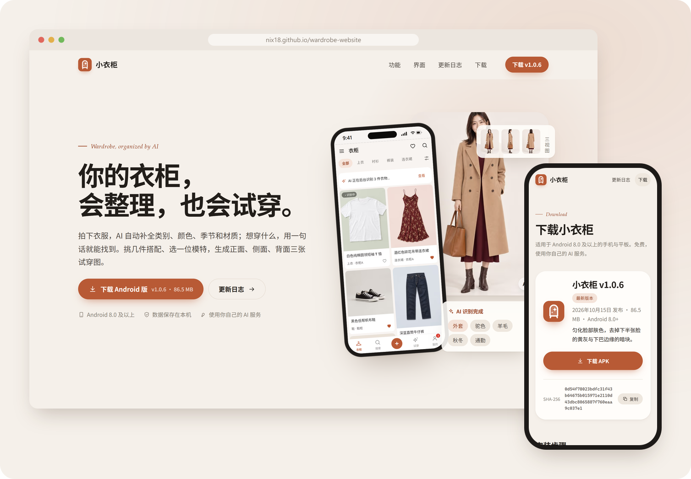
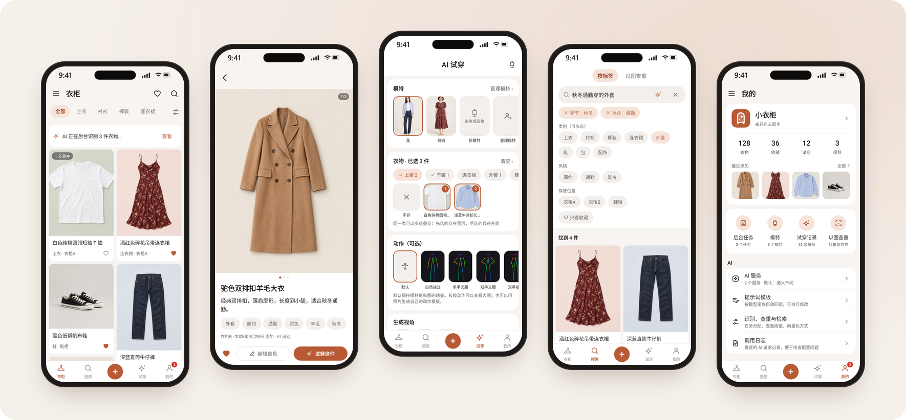

<p align="center">
  
</p>

<h1 align="center">小衣柜 · 网站</h1>

<p align="center">
  <a href="https://nix18.github.io/wardrobe-website/">nix18.github.io/wardrobe-website</a>
</p>

<p align="center">
  <a href="https://github.com/nix18/wardrobe-website/releases/latest"></a>
  
  
</p>



小衣柜是一个 Android 衣橱应用：拍照收衣服，AI 补标签，一句话找出来，挑几件生成正面、侧面、背面的试穿图。这里是它的网站，安装包也发在这个仓库的 [Releases](https://github.com/nix18/wardrobe-website/releases)。



## 页面

| 路径 | 内容 |
| --- | --- |
| `/` | 功能、试穿流程、界面截图、最近更新、常见问题 |
| `/download/` | 最新版、安装步骤、SHA-256 |
| `/download/history/` | 历史版本 |
| `/changelog/` | 最近 3 个版本，再往前的收在“更多版本”里 |
| `/privacy/` | 隐私政策，和应用里的一致 |

首页的界面截图跟着滚轮走：往下滚时横向滑动，滑到最后一张再继续往下。深色模式跟随系统。没有用前端框架，样式都在 `src/styles/global.css`。

## 本地跑

Node.js 22.12 以上。

```bash
npm ci
npm run dev       # http://localhost:4321/wardrobe-website/
npm run deploy    # 构建，推到 gh-pages 分支，Pages 从那里发布
```

## 发新版

应用打好正式包之后：

```bash
npm run release -- 1.0.7 --apk wardrobe-1.0.7.apk --notes v1.0.7.md --summary "一句话摘要"
git add src/content/releases && git commit -m "发布 v1.0.7" && git push
npm run deploy
```

`release` 把安装包传到 Releases（说明末尾附 SHA-256），再写一份 `src/content/releases/v1.0.7.md`。更新说明里的“## 下载”一节会被去掉，其他想去掉的小节用 `--drop 标题`。首页、下载页、更新日志都从这些文件读版本。

## 图片

| 目录 | 怎么来的 | 怎么重新生成 |
| --- | --- | --- |
| `src/assets/screens/` | 应用的截图测试 | 在应用仓库跑 `./gradlew :app:testDebugUnitTest -Pscreenshots` |
| `src/assets/photos/` | 图像模型，提示词在 `art/photo-prompts.mjs` | `npm run gen-images`，要设 `IMAGE_API_BASE`、`IMAGE_API_KEY` |
| `public/og.png`、`public/icon-180.png` | 分享预览图、触屏图标 | `npm run og-image` |
| `docs/readme/` | 这份 README 的配图 | `npm run readme-images`，网站预览图要另外传两张截图 |

示例照片也是应用截图测试里的样图。网站上的模特、衣物和试穿图都是 AI 生成的，页脚写明了。
